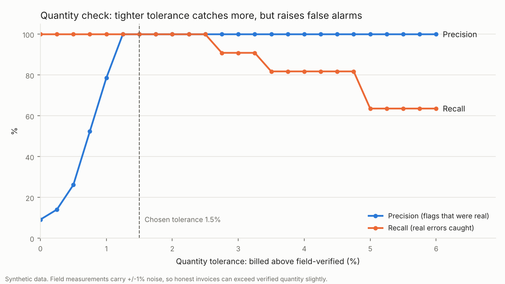

# Multi-Prime Commercial Control Tower

**Invoice governance for a multi-prime data center construction program: 3-way matching, pre-approval gates and analytics-driven holds.**

> **All data is synthetic.** Contractors, sites, quantities and rates are fictional and illustrative. This is an independent portfolio project showing how I would approach commercial governance on a large multi-prime build. It is not affiliated with any company and makes no claim about any company's internal processes.

---

## The problem

On a hyperscale data center program, the owner often contracts **several prime contractors directly** (electrical, mechanical, civil) instead of using one general contractor. That means the owner's commercial team receives a stream of pay applications from multiple primes across multiple buildings, and each one has to be checked before payment:

- Does the **rate** match the contract or approved change order? *(PO leg)*
- Does the **quantity** billed match what the field team verified as installed? *(receipt leg)*
- Is **lump-sum % complete** in line with verified progress?
- Was **extra work** (change orders, T&M hours) **pre-approved**?
- Are **per diem**, **retainage** and the **arithmetic** right? Is this a **duplicate** submission?

Done by hand, this is slow and inconsistent. This project automates it as rules in SQL, sorts every invoice into **PASS / REVIEW / HOLD**, and measures how accurate the rules are.

## What's in Week 1 (this release)

| Component | File | What it does |
|---|---|---|
| Synthetic data generator | `src/generate_data.py` | 6 buildings on 3 campuses × 3 primes, monthly pay apps over 8 months with staggered starts, with POs, change orders, T&M pre-approvals, field verifications, and **9 types of deliberately planted billing errors** |
| Match + gate engine | `sql/engine.sql`, `src/run_engine.py` | 10 governance rules in standard SQL (DuckDB locally, written to port to BigQuery) → `exceptions`, `invoice_gates`, `prime_scorecard` |
| Evaluation | `src/evaluate.py` | Precision/recall per rule against the planted ground truth, invoice-level confusion matrix, $ caught, and a tolerance trade-off sweep |
| Web app | `app.py` | Streamlit app with project / contractor / month filters: **This week's decisions** (plain-English findings with $ and recommended actions), **Portfolio** (contract vs billed vs verified per building), **Contractors** (scorecard, monthly trend, rate comparison), invoice drill-down, exceptions, accuracy and stress test |
| Insights engine | `src/insights.py` | Turns exceptions into management information: $ at risk by issue, project hotspots, billing ahead of verified work, pending change-order exposure, contractor trends, same-item price spread |
| Input checker | `src/validate_input.py` | Catches mapping mistakes (formats, broken links between tables, missing receipts) before the engine runs |
| Stress test | `src/inject_errors.py` | Tests the engine on **any** data, including real data with no answer key: plants known errors in a copy and reports caught / missed / new false alarms |
| Templates | `templates/`, `DATA_DICTIONARY.md` | Blank CSVs and column definitions for loading your own data |

## Interface

Four pages, in a dark "orbital" theme:

| Page | What it shows |
|---|---|
| **Mission Control** | A 3D Earth (NASA Blue Marble imagery) with a pin at each project's coordinates, colored by health; an automatic camera tour; one card per program with a pixel animation of the structure assembling to its verified % complete |
| **Insights** | One card per project: health score (0-100) with cost, schedule, billing and cash sub-scores, key numbers and flags |
| **Project** | Deep dive for one project: live build animation, location close-up, 12 KPIs, progress vs plan with a forecast to completion, cost bridge, bills by gate, money at risk by issue, rates vs program median, live insights and evidence |
| **Program analytics** | All manager views (decisions, root causes, contractors, schedule and penalties, cash flow, policy simulator) and the evidence tabs |

The health score formula is in `src/health.py` and is explained on the Insights page.
Globe library and Earth textures load from a version-pinned public CDN (globe.gl 2.46.2, three-globe 2.45.6).
Project coordinates are in `projects.csv` (`latitude`, `longitude`, `location`, `structure`).
The West Texas campuses are fictional, so their locations are illustrative.

## Manager views (program-manager layer)

The engine checks every bill like a clerk would; the manager views turn those checks into decisions:

| View | Question it answers |
|---|---|
| Manager overview | Budget vs forecast at completion, % verified vs planned, status and *why* per project |
| This week's decisions | Ranked actions across cost, schedule, cash and billing, each with $ impact and an owner |
| Root causes | Why bills fail, who owns the fix, and the first-pass rate if each cause is fixed |
| Contractors | Score (first-pass, accuracy, schedule), trend, repeat issues, rate benchmarking vs program median |
| Schedule & penalties | Planned vs forecast finish, schedule index, delay-penalty (LD) exposure |
| Cash flow | Paid, unpaid, overdue, retention held, advance recovery, next month's cash need, flagged money already paid |
| Policy simulator | Strict vs current vs loose checking: workload, money blocked, errors caught, overbilling missed |

These use three optional files (`project_controls`, `baseline_plan`, `payments`; see DATA_DICTIONARY.md).
Two demos include them: the synthetic West Texas data center program and the North Koel canal program
(4 contracts built from real WAPCOS tender documents, amounts converted at Rs 95 = $1).

## Data model

```
projects ─┐
primes ───┼─> purchase_orders ──> po_lines (contract SOV lines + approved change-order lines)
          │         │
          │         ├──> change_orders      (APPROVED / PENDING / REJECTED)
          │         ├──> tm_preapprovals    (approved T&M hours per craft per month)
          │         ├──> goods_receipts     (field-verified qty, or verified % complete for lump sums)
          │         └──> invoices ──> invoice_lines (SOV, CO, TM, PER_DIEM)
          │
ground_truth_errors  (answer key - used ONLY by evaluate.py, never by the engine)
```

## Governance rules

| # | Rule | 3-way match leg / gate | Severity |
|---|---|---|---|
| 1 | `RATE_OVER_CONTRACT` | Invoice vs **PO** rate | HOLD if > 0.5% |
| 2 | `QTY_OVER_RECEIPT` | Invoice vs **receipt** (field-verified qty) | REVIEW > 1.5%, HOLD > 5% |
| 3 | `PCT_COMPLETE_OVERBILL` | Lump-sum % billed vs verified % | REVIEW > 1 pt, HOLD > 5 pts |
| 4 | `UNAPPROVED_CO` | **Pre-approval**: change order not approved (or not on file) | HOLD |
| 5 | `TM_OVER_APPROVED` / `TM_NOT_PREAPPROVED` | **Pre-approval**: T&M hours vs approved | REVIEW > 0%, HOLD > 10% |
| 6 | `PER_DIEM_OVER_POLICY` | Per diem rate vs policy cap | HOLD |
| 7 | `EXTENSION_ERROR` | Amount ≠ qty × rate | HOLD |
| 8 | `RETAINAGE_ERROR` | Withheld ≠ 10% of SOV + CO work | HOLD |
| 9 | `DUPLICATE_INVOICE` | Same PO + period + amount as an earlier invoice | HOLD |
| 10 | `NO_RECEIPT`, `HEADER_MISMATCH` | Sanity checks | HOLD |

An invoice's gate is its **worst** exception. **Amount at risk** is the overbilled portion (or the whole invoice for duplicates).

## Methods

- **Synthetic data with realistic noise:** progress follows S-curves. Field-verified quantities carry ±1% measurement noise, so a perfectly honest invoice can still bill slightly more than was verified. Planted errors vary in size, and some are small enough to hide in that noise.
- **Rule-based 3-way matching in SQL:** one view per rule, unioned into an exceptions table; gate = worst severity.
- **Evaluation like an ML model:** precision (were the flags real?) and recall (were real errors caught?) per rule, plus a confusion matrix at invoice level.
- **Tolerance tuning:** sweep the quantity tolerance from 0% to 6% and pick the value that balances false alarms against missed errors.
- **Hold-out testing:** tolerances were chosen on one random dataset (seed 42), then tested unchanged on three new datasets.

## Results (synthetic)

**Development dataset (seed 42):** 6 buildings × 3 primes, 117 pay applications, $420M billed, 67 planted errors worth $17.5M.

| Metric | Result |
|---|---|
| Precision / recall, all rules | 98.5% / 100% |
| Clean invoices wrongly stopped | 1 of 67 (sent to REVIEW, not HOLD) |
| Invoices with errors that passed | 0 of 50 |

The one false alarm is a lump-sum line billed 1.1 points above a verified % complete that itself carries measurement noise.

**Hold-out datasets (tolerances not retuned):**

| Seed | Planted errors | Precision | Recall |
|---|---|---|---|
| 7 | 76 | 100% | 100% |
| 2026 | 55 | 98.2% | 100% |
| 99 | 72 | 100% | 100% |

**Stress test on clean data** (40 planted errors, 25% deliberately tiny): 82–93% recall with 0 new false alarms, and every miss was one of the tiny errors below tolerance. With no tiny errors: 100%.

**Tolerance trade-off for the quantity check:**



At 0% tolerance the rule flags 163 honest lines (8% precision), because field measurement noise looks like overbilling. From 1.25% to 3.25% both precision and recall are 100%; above that, real overbills start slipping through. **1.5%** sits in the safe band. In a live program this threshold would be set from the actual measurement accuracy of each work type.

## Honest limitations

- **The rules were written knowing which errors were planted**, so near-perfect scores on synthetic data are expected and are *not* evidence of real-world accuracy. The hold-out runs and the tolerance sweep are the more meaningful results.
- Real invoices arrive as PDFs in inconsistent formats. Extraction errors will lower accuracy. Week 3 (AI invoice reader) tests this.
- Real duplicates are often *partial* resubmissions with different totals. This version only catches exact-amount duplicates.
- Quantities are checked per period, not cumulatively against contract quantity. A cumulative check is a planned addition.
- Rates, per diem caps and retainage terms are illustrative, not taken from any real contract.

## Run it

```bash
pip install -r requirements.txt
./run_all.sh                       # or run the three scripts in src/ in order
streamlit run app.py               # web app at http://localhost:8501
MPCT_SEED=7 python src/generate_data.py && python src/evaluate.py   # hold-out test

# Your own data
python src/validate_input.py --data data/my_project
python src/run_engine.py --data data/my_project --out outputs/my_project
python src/inject_errors.py --data data/my_project --n 40 --subtle 0.25
```

Full setup, deployment and real-data testing guide: **[DEPLOY_AND_USE.md](DEPLOY_AND_USE.md)**

**Stress test on clean synthetic data (40 planted errors, 25% deliberately tiny, 4 seeds):** 93–100% recall, 0 new false alarms; every miss was a tiny error below tolerance.

Outputs land in `outputs/`: `exceptions.csv`, `invoice_gates.csv`, `prime_scorecard.csv`, `evaluation_report.md`, `tolerance_sweep.csv`, `tolerance_tradeoff.png`.

## Roadmap

| Week | Module |
|---|---|
| 1 ✅ | 3-way match + pre-approval engine, evaluation, web app, real-data stress test, portfolio filters and decision insights |
| 2 | **Cost intelligence:** $/sq ft benchmark of Texas data center projects from public filings · **Rate benchmarking** with TxDOT bid tabulations and GSA per diem rates |
| 2–3 | **Governance dashboard:** BigQuery + Looker Studio (gates by prime, cycle time, $ held, top exception types) |
| 3 | **AI invoice reader:** an LLM extracts line items from PDF pay applications and drafts exception memos; extraction accuracy measured against ground truth |
| 4 | Two-page governance gate framework memo + walkthrough video |

## Porting the SQL to BigQuery

The SQL avoids DuckDB-only features. To run it in BigQuery: prefix table names with your dataset (`mpct.invoices`), change `CAST(... AS VARCHAR)` to `CAST(... AS STRING)`, and load `params` as a one-row table.

---
*Author: Manish Kumar · Built with AI-assisted development; problem framing, controls design, tolerance choices and interpretation are my own.*
