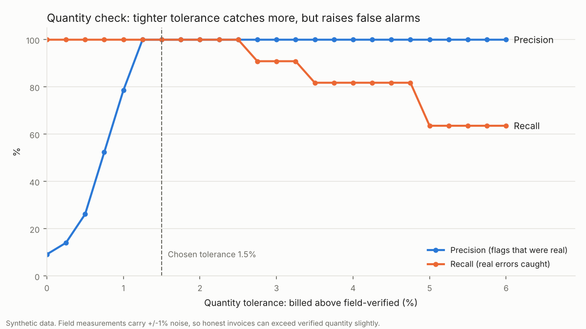

# Evaluation report (synthetic data)

Engine run with default tolerances: `{'qty_review_pct': 1.5, 'qty_hold_pct': 5.0, 'rate_hold_pct': 0.5, 'pct_review_pts': 1.0, 'pct_hold_pts': 5.0, 'tm_review_pct': 0.0, 'tm_hold_pct': 10.0, 'money_tol': 1.0}`

## Detection by rule

| rule                  |   planted |   flagged |   true_pos |   false_pos |   missed |   precision_pct |   recall_pct |
|:----------------------|----------:|----------:|-----------:|------------:|---------:|----------------:|-------------:|
| DUPLICATE_INVOICE     |         5 |         5 |          5 |           0 |        0 |             100 |          100 |
| EXTENSION_ERROR       |         9 |         9 |          9 |           0 |        0 |             100 |          100 |
| PCT_COMPLETE_OVERBILL |        10 |        10 |         10 |           0 |        0 |             100 |          100 |
| PER_DIEM_OVER_POLICY  |        13 |        13 |         13 |           0 |        0 |             100 |          100 |
| QTY_OVER_RECEIPT      |        11 |        11 |         11 |           0 |        0 |             100 |          100 |
| RATE_OVER_CONTRACT    |         9 |         9 |          9 |           0 |        0 |             100 |          100 |
| RETAINAGE_ERROR       |         5 |         5 |          5 |           0 |        0 |             100 |          100 |
| TM_OVER_APPROVED      |        17 |        17 |         17 |           0 |        0 |             100 |          100 |
| UNAPPROVED_CO         |        11 |        11 |         11 |           0 |        0 |             100 |          100 |
| ALL RULES             |        90 |        90 |         90 |           0 |        0 |             100 |          100 |

## Invoice-level gate outcome

| has_error         |   PASS |   REVIEW |   HOLD |
|:------------------|-------:|---------:|-------:|
| Clean             |     24 |        0 |      0 |
| Has planted error |      0 |        2 |     51 |

**Planted overbilling caught:** $20,713,673 of $20,713,673 (100.0%)

## Missed errors

None.

## False alarms

None.

## Quantity tolerance trade-off

|   tolerance_pct |   precision_pct |   recall_pct |   false_pos |   missed |
|----------------:|----------------:|-------------:|------------:|---------:|
|            0    |             9.2 |        100   |         109 |        0 |
|            0.25 |            14.1 |        100   |          67 |        0 |
|            0.5  |            26.2 |        100   |          31 |        0 |
|            0.75 |            52.4 |        100   |          10 |        0 |
|            1    |            78.6 |        100   |           3 |        0 |
|            1.25 |           100   |        100   |           0 |        0 |
|            1.5  |           100   |        100   |           0 |        0 |
|            1.75 |           100   |        100   |           0 |        0 |
|            2    |           100   |        100   |           0 |        0 |
|            2.25 |           100   |        100   |           0 |        0 |
|            2.5  |           100   |        100   |           0 |        0 |
|            2.75 |           100   |         90.9 |           0 |        1 |
|            3    |           100   |         90.9 |           0 |        1 |
|            3.25 |           100   |         90.9 |           0 |        1 |
|            3.5  |           100   |         81.8 |           0 |        2 |
|            3.75 |           100   |         81.8 |           0 |        2 |
|            4    |           100   |         81.8 |           0 |        2 |
|            4.25 |           100   |         81.8 |           0 |        2 |
|            4.5  |           100   |         81.8 |           0 |        2 |
|            4.75 |           100   |         81.8 |           0 |        2 |
|            5    |           100   |         63.6 |           0 |        4 |
|            5.25 |           100   |         63.6 |           0 |        4 |
|            5.5  |           100   |         63.6 |           0 |        4 |
|            5.75 |           100   |         63.6 |           0 |        4 |
|            6    |           100   |         63.6 |           0 |        4 |

